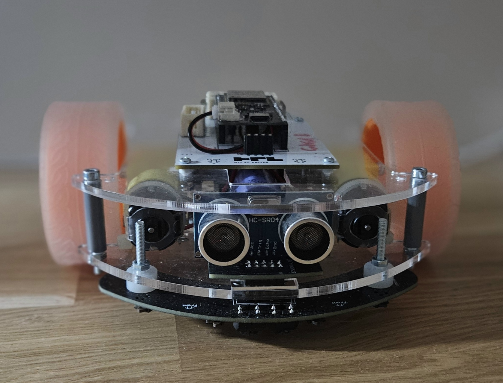

# myRobot

Firmware for an ESP32-based robot, written in C++ with PlatformIO (Arduino framework).

The robot itself was built in my 2nd year at HTL St. Pölten. I keep developing the software privately, and **on purpose without AI tools**: the goal is to apply what I have learned myself.



## Features

- **Line follower** with smoothed sensor values (moving average)
- **Colour detection** with a TCS34725 sensor and threshold-based classification
- **Collision warning and detection** with an ultrasonic distance sensor
- **Drive adjustment**: keeps both wheels at the same speed using the wheel sensor pulses
- **Battery measurement** with voltage, charge level and state
- **RGB LEDs** (FastLED)
- **Web interface** with live telemetry (battery, line sensor values), served from the ESP32's flash file system
- **Non-blocking**: timing with `millis()` instead of `delay()`
- **Modular**: every component can be switched on or off with a build flag

Planned: control with a PS5 controller (`USE_PS5_CONTROLLER`).

## Structure

| Path | Content |
|---|---|
| `src/main.cpp` | Setup and main loop |
| `lib/myRobot/` | Robot functions: driving, line follower, colour sensor, collisions, battery, LEDs, web server |
| `lib/syscore/` | System functions: file system (LittleFS or SPIFFS) and WiFi connection |
| `data/` | Web interface files, uploaded to the ESP32's file system |

## Build flags

Components are enabled with build flags in `platformio.ini`:

| Flag | Enables |
|---|---|
| `USE_LINEFOLLOWER` | Line follower |
| `USE_COLORSENSOR` | TCS34725 colour sensor (required by `USE_LINEFOLLOWER`) |
| `USE_LEDS` | RGB LEDs |
| `USE_WEBSERVER` | Web interface |
| `USE_LITTLEFS` | LittleFS instead of SPIFFS |

## Setup

1. Create `data/WiFi.txt` (it is in `.gitignore` and never committed). Line 1 is the WiFi **password**, line 2 the **SSID**. A template is in `data/WiFi.example.txt`.
2. Adjust the static IP address in `lib/syscore/syscore.cpp` to your network.
3. Upload the file system and the firmware. The first upload has to be done over USB; after that, `platformio.ini` uploads over the air (OTA) to the robot's IP address (`upload_port`).

```bash
pio run -t uploadfs
pio run -t upload
pio device monitor
```

4. Open the robot's IP address in the browser to see the web interface.

## Libraries

- [ESPAsyncWebServer](https://github.com/me-no-dev/ESPAsyncWebServer)
- [Adafruit TCS34725](https://github.com/adafruit/Adafruit_TCS34725)
- [FastLED](https://github.com/FastLED/FastLED)